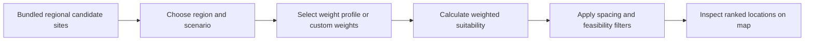

# EVORA — EV Charging Site Decision Studio

**Explore, rank and compare candidate EV charging locations in Madhya Pradesh.** EVORA is an interactive React decision-support prototype that makes site-scoring assumptions visible instead of presenting a recommendation as an unquestionable answer.

**[Open published Vercel preview](https://evora-smoky.vercel.app/)** · [Source code](https://github.com/OM2412/evora) · [Decision map](https://evora-smoky.vercel.app/decision-map)

> **Data boundary:** Candidate locations and factor scores are bundled in the frontend source. This is a transparent scenario-planning demonstration—not a validated national EV-demand forecast, live charger-availability feed or investment recommendation. Verify feasibility, grid capacity, permitting, land access, demand and local conditions independently.

## What you can explore

- **Regional decision map:** Switch among Madhya Pradesh study areas and inspect candidate charging sites on an interactive Leaflet map.
- **Four weighted factors:** Estimated demand, accessibility, charging-coverage gap and renewable-energy potential.
- **Explainable ranking:** Compare default weight profiles (balanced, demand, renewable and coverage) or apply custom weights.
- **Scenario controls:** Choose a target station count and minimum spacing to explore alternative selections.
- **Site checks:** Mark safety/feasibility checks as pending, verified or unsuitable; unsuitable sites can be excluded from a scenario.
- **Map layers and site detail:** Show candidate/recommended sites and inspect factor contributions rather than relying on a single opaque score.

## Decision pipeline



A site's weighted score is computed from its factor scores and normalized weights. The default balanced profile uses **35% demand, 25% accessibility, 25% charging gap and 15% renewable potential**. The score is a relative decision aid, not a measured probability of commercial success.

## Stack

| Area | Technology |
| --- | --- |
| UI | React 19, JavaScript, CSS |
| Build tooling | Vite 8, ESLint |
| Mapping | Leaflet and React Leaflet |
| Routing | React Router |
| Deployment | Vercel preview URL above |

## Run locally

Requires a recent Node.js version compatible with Vite 8 and npm.

```bash
git clone https://github.com/OM2412/evora.git
cd evora
npm ci
npm run dev
```

Open the local URL printed by Vite.

```bash
npm run lint
npm run build
npm run preview
```

## Code map

| Location | Responsibility |
| --- | --- |
| `src/pages/LandingPage.jsx` | Concept and methodology landing page |
| `src/pages/DecisionMapPage.jsx` | Map interactions, weights and applied scenarios |
| `src/data/mpRegions.js` | Region selection and candidate data |
| `src/data/candidateSites.js` | Example candidate coordinates and factor scores |
| `src/utils/siteScoring.js` | Weighted scoring and ranking |
| `src/utils/siteOptimization.js` | Scenario selection and validation metrics |
| `src/components/dashboard/` | Map, controls, summaries and site panels |

## Limitations and next steps

The bundled scores are demonstration inputs rather than audited real-world measurements. A production planning system would require data provenance, demand and utilization forecasts, charger/grid supply verification, accessibility measurements, sensitivity analysis, uncertainty intervals, licensing checks and field validation. Do not treat the generated ranking as permission to build at any specific location.

**Availability note:** The preview link is the URL published in this repository's GitHub metadata; deployment uptime was not independently rechecked as part of this documentation update.
